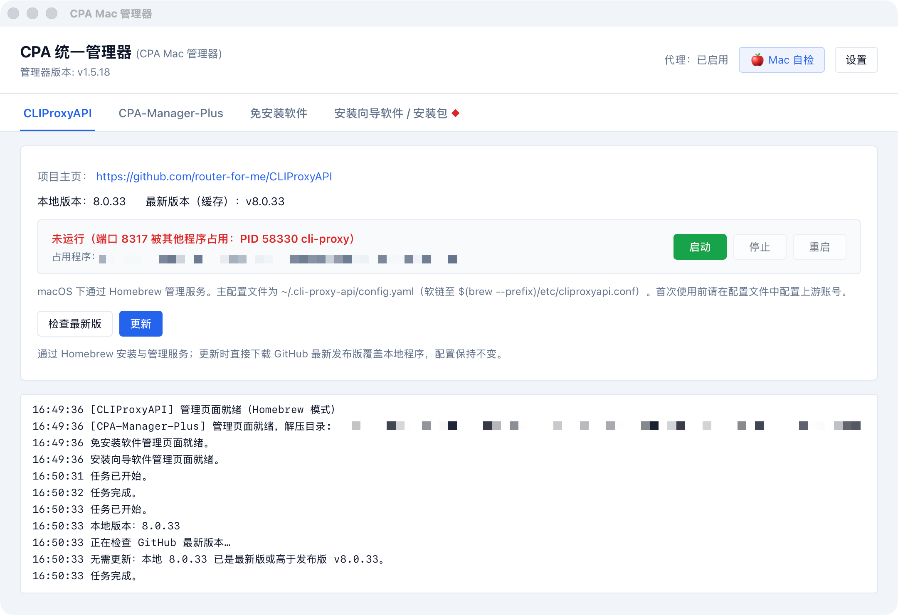
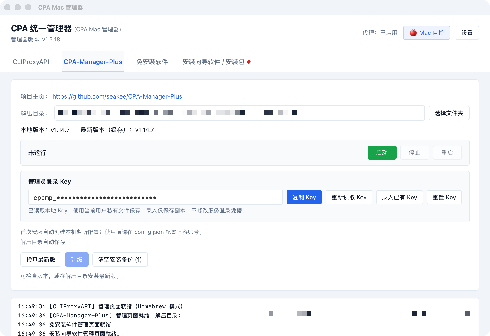
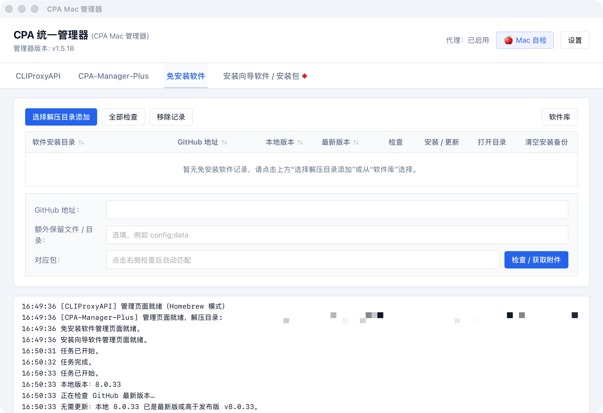
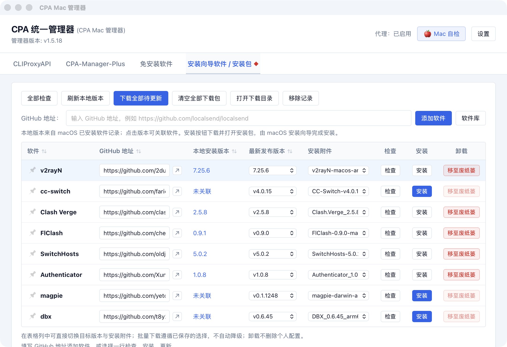
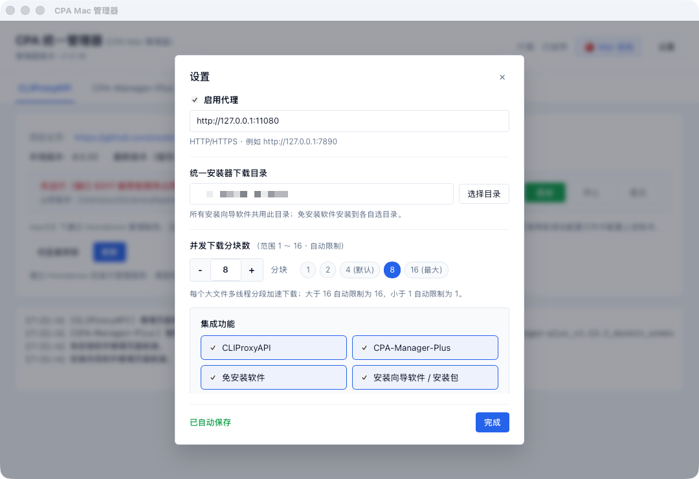

# CPA Mac 管理器

macOS 上管理 [CLIProxyAPI](https://github.com/router-for-me/CLIProxyAPI) 和 [CPA-Manager-Plus](https://github.com/seakee/CPA-Manager-Plus)，也可以安装带 GitHub Release 的免安装软件和 dmg/pkg。

提供了两种独立打包方案：
1. **Tauri 原生桌面端（推荐）**：位于 `mac/tauri/`，体积仅约 5~8 MB，基于 Rust + 系统 WKWebView 原生窗口，无需预装 Python，独立打包为 `.app` 与 `.dmg`。
2. **Python 模块化端**：位于 `mac/cpa_mac/`，前端解耦至 `mac/cpa_mac/ui/web/`，支持原生 WebKit 窗口与浏览器模式回退。

---

## 界面截图







## 功能特性

- **服务生命周期管控**：按本机架构下载 darwin 安装包，校验 SHA256，安装、启动、停止、重启。已有 `config.yaml` / `config.json` 不会被覆盖。服务启动后一键直达 Web 控制台（`/management.html`）。
- **免安装软件管理**：支持 zip、tar.gz、tar.xz、tar.bz2 和单文件，优先选择 darwin 且架构匹配的附件。每行可以单独检查或安装，有新版本时标出红点与可更新标识。
- **安装包向导管理**：下载 dmg/pkg 后用系统打开。下载目录里已有且校验通过的文件直接复用。
- **内置软件库与搜索**：内置高效开发工具库（ripgrep、fd、jq、wezterm 等），支持根据仓库名称直接搜索与一键添加。
- **网络与并发优化**：支持 HTTP/HTTPS 代理配置，1~16 多线程分块并发下载，支持断点续传；支持预发布版本（Pre-release）勾选开关；集成 10 分钟 Release 目录缓存与 403 速率限制自动回退网页抓取。
- **安全沙箱存储**：数据与设置保存在 `~/Library/Application Support/CPA-Unified-Manager/`，权限仅当前用户可读写。

---

## 方案 A：Tauri 原生桌面端打包（推荐，极简轻量）

代码位于 `mac/tauri/`，采用 Tauri v2 + Rust 构建，拥有极佳的性能与极小的打包体积（~5MB）。

### 1. 独立打包（在 macOS 下执行）
```bash
cd mac/tauri
chmod +x build.sh
./build.sh
```
或者通过 npm：
```bash
cd mac/tauri
npm install
npm run build
```

打包完成后，产物位于 `mac/tauri/src-tauri/target/release/bundle/`：
- `dmg/CPA Mac Manager.dmg`：开箱即用的安装盘映像。
- `macos/CPA Mac Manager.app`：原生独立应用程序。

也可以在 `mac/` 根目录下直接运行：
```bash
./build_mac.sh tauri
```

---

## 方案 B：Python 模块化版本运行与打包

前端已抽离至 `mac/cpa_mac/ui/web/`（`index.html`、`style.css`、`app.js`），支持原生 WebKit 窗口（安装 pywebview 时）或默认浏览器。

### 1. 运行与测试
```bash
cd mac
python3 -m venv .venv
source .venv/bin/activate
pip install -r requirements.txt
python manager.py
```

执行单元测试：
```bash
python -m unittest discover -s tests -v
```

### 2. PyInstaller 打包构建
```bash
cd mac
chmod +x build_mac.sh

# 默认生成原生应用 CPA Mac Manager.app 并制作 DMG 安装镜像
./build_mac.sh

# 仅生成应用包
./build_mac.sh app

# 生成命令行单文件二进制
./build_mac.sh cli

# 一键打包 .app, .dmg 和 cli
./build_mac.sh all
```

---

## 使用与权限说明

1. **双击启动**：
   双击 `CPA Mac Manager.app` 即可直接打开管理界面。
2. **解除 Gatekeeper 隔离（若 macOS 拦截未签名应用）**：
   若首次打开提示“无法验证开发者”或“已损坏”，在终端中执行解除隔离命令：
   ```bash
   sudo xattr -rd com.apple.quarantine "/Applications/CPA Mac Manager.app"
   ```